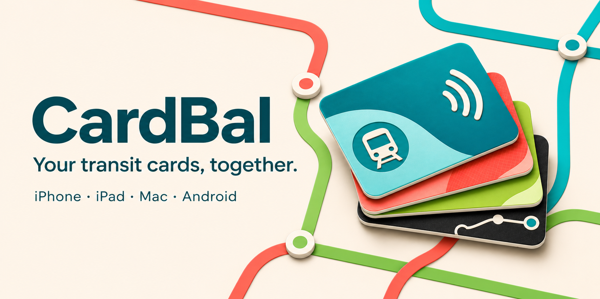
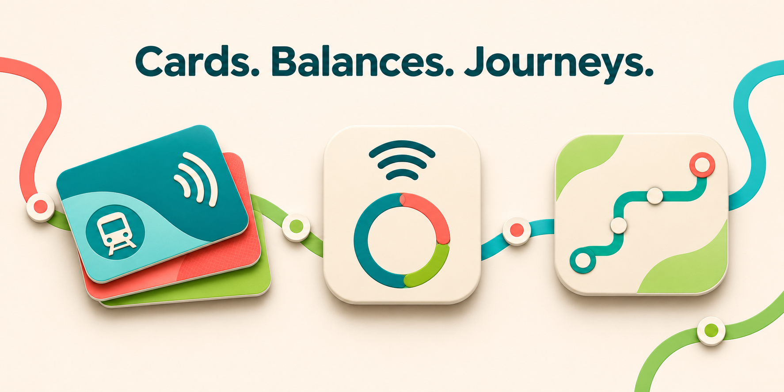

# CardBal

[English](README.md) | [简体中文](README.zh-CN.md) | 日本語

CardBal は iPhone、iPad、Mac、Android 向けの交通系 IC カードリーダーです。
カードの残高や最近の利用履歴を確認し、複数のカードをウォレットにまとめられます。

Suica、PASMO、ICOCA、八達通、T-money、EZL/Cashbee、中国交通聯合、
EZ-Link などに対応しています。読み取れる残高や履歴はカードによって異なります。

## 主な機能

- 対応カードの残高や最近の取引を読み取り
- カード名、色、券面をカスタマイズして保存
- 駅データのある乗車履歴を地図に表示
- ウォレットをバックアップし、iPhone と Android 間で移行

## 対応端末

| 端末 | リーダー |
| --- | --- |
| iPhone | 内蔵 NFC または対応する外付け USB リーダー |
| Android | 端末の NFC リーダー |
| iPad・Mac | 対応する外付け USB NFC / CCID リーダーが必要 |

## はじめに

- [ダウンロード](https://github.com/iebb/TransitICReader/releases)
- [対応カード](docs/decoding/capabilities.md)
- [駅データと経路カタログ — card-stations](https://github.com/iebb/card-stations)
- [外付けリーダーの設定](docs/development/external-nfc-readers.md)
- [ビルドと開発ガイド](docs/README.md)
- [ライセンスとクレジット](docs/licenses/README.md)

リンク先のドキュメントは英語です。
