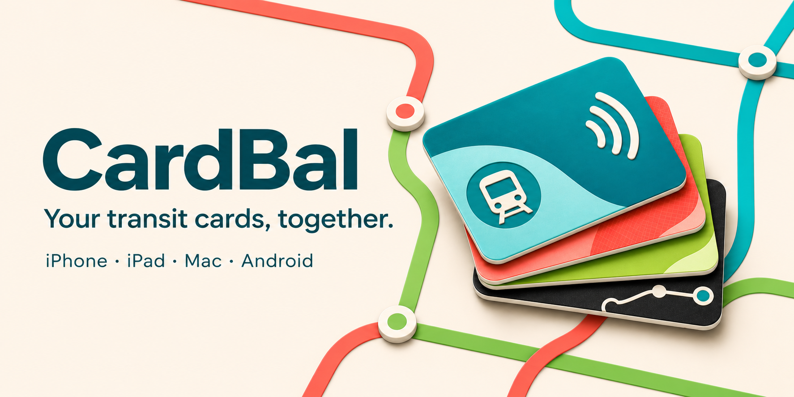
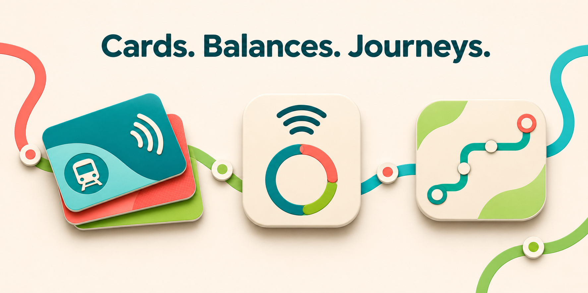

# CardBal

English | [简体中文](README.zh-CN.md) | [日本語](README.ja.md)

CardBal is a transit IC-card reader for iPhone, iPad, Mac and Android.
Check your card's balance, look back through recent trips and keep your cards
together in a wallet.

Supported cards include Suica, PASMO, ICOCA, Octopus, T-money, EZL/Cashbee,
China T-Union, EZ-Link and more. Available balances and records vary by card.

## Features

- Read balances and recent transactions from supported cards.
- Save cards with custom names, colours and card faces.
- View journeys on a map where station data is available.
- Back up your wallet and move it between iPhone and Android.

## Platforms

| Platform | Reader |
| --- | --- |
| iPhone | Built-in NFC or a compatible external USB reader |
| Android | The device's NFC reader |
| iPad and Mac | A compatible external USB NFC / CCID reader |

## Get started

- [Downloads](https://github.com/iebb/TransitICReader/releases)
- [Supported cards](docs/decoding/capabilities.md)
- [Station data and routing catalog — card-stations](https://github.com/iebb/card-stations)
- [External reader setup](docs/development/external-nfc-readers.md)
- [Build and development guides](docs/README.md)
- [Licences and credits](docs/licenses/README.md)
